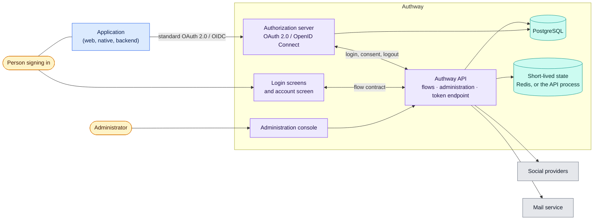

# Authway design

The design of Authway as it is now: what it is, how a sign-in travels through it,
and the rules the accounts keep. It describes the current design only; when the
design changes the page is rewritten. What Authway is for and where it stops is
in the constitution (`docs/CONSTITUTION.md`) and the scope (`docs/scope.md`);
how to use it is in `docs/`.

## Reading order

| Page | Level | Answers |
|---|---|---|
| This page | L0 | What Authway is, who and what it meets, what each part is responsible for |
| [deployment.md](deployment.md) | L1 | Which processes make up a deployment, and how they talk |
| [sign-in-flow.md](sign-in-flow.md) | L2 | In what order an application, the browser, the API and the authorization server cooperate until the application holds a token |
| [accounts.md](accounts.md) | L3 | What an account is made of, and which rules about how it signs in always hold |
| [languages.md](languages.md) | L3 | In which language a person reads a screen, an error or a mail, and who decides |

## Project map

**Question:** what is Authway, who and what does it meet, and what is each part responsible for?
**Level:** L0 · **Baseline:** `a5a7056` (`apps/`, `packages/`) · **Source:** this page; the contract is
`packages/contract/openapi.yaml`

| Part | Responsible for | Code starts at |
|---|---|---|
| Authorization server | The OAuth 2.0 / OpenID Connect protocol: authorization codes, tokens, sessions, discovery. Authway runs an existing server (Ory Hydra) and adds nothing to the protocol | `configs/`, `deploy/` |
| Authway API | Everything a sign-in needs that the protocol does not say: the login, consent and logout flows, accounts and tenants, the administration API, the token endpoint in front of the authorization server, audit, webhooks | `apps/central/api` |
| Login screens | Showing the flows to a person: sign in, second factor, consent, invitation, password reset, the account screen | `apps/branding/auth-ui` |
| Administration console | Administering tenants, applications, users and audit | `apps/central/admin` |
| Contract and conformance suite | What any Authway answers — the part an application relies on — and the scenarios that check it | `packages/contract`, `packages/conformance` |
| SDKs | Signing in from a browser or a React application; the administration API from .NET | `packages/client`, `packages/react`, `clients/csharp` |

An application never talks to the API's own endpoints to sign a person in: it
speaks standard OAuth 2.0 and OpenID Connect to the authorization server, and
finds the endpoints by discovery. The API's endpoints are for the login screens
and for administration.
