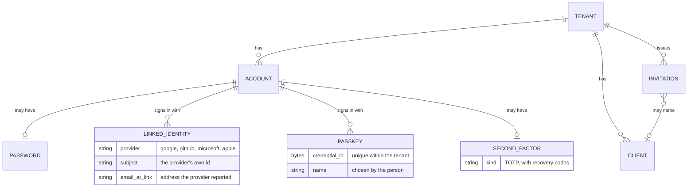

# Accounts and how they sign in

**Question:** what is an account made of, and which rules about how it signs in
always hold?
**Level:** L3 · **Baseline:** `a5a7056` (`apps/central/api/pkg/user`), `0304bae`
(`apps/central/api/pkg/passkey`) · **Source:** this page; behavior is pinned by the
conformance scenarios for accounts, connections and passkeys

An account belongs to exactly one tenant. Its ways to sign in are separate
records, so that adding, removing and checking them are the same operations
whatever the way is.

## Ways to sign in

| Way | Record | Notes |
|---|---|---|
| Password | The account's password hash | May be absent: an account that signs in another way has none |
| Emailed link | None — the account's address | Gated by the tenant's sign-up policy like every other way |
| Provider account | One `LINKED_IDENTITY` per provider account | An account may have several, at one provider and at several |
| Passkey | One `PASSKEY` per registered credential | A discoverable, user-verified credential, bound to the login screen's host |

A second factor, when the account has one, is asked after whichever first factor
was used.

## Rules that always hold

1. **A tenant is a wall.** A provider account, a passkey and an address belong to
   the account in one tenant; the same person in two tenants has two accounts, and
   a credential of one tenant never opens another. A provider account is unique
   within a tenant (tenant, provider, subject); a passkey's credential id is
   unique within a tenant only.
2. **The last way in stays.** Removing a way to sign in is refused when it is the
   account's last one — a password, a provider account or a passkey. Removals that
   race for the last one are serialized, so the check cannot be passed by two
   requests at once.
3. **A link is made only on a verified address.** A provider account links to an
   existing account automatically only when the provider verified the address and
   the account's own address is verified; otherwise the person signs in to the
   account first and adds the provider account from the account screen.
4. **A token an application holds is not the person.** A way to sign in that the
   account did not have — a first password, a passkey — is added with a token
   issued to the **account screen** and a recent sign-in; another application's
   token is refused, so an application cannot choose a way in for the person.
   Adding a provider account is finished in the person's own browser with their
   own token, so a link forced onto their browser cannot attach anyone's account
   to anyone's.
5. **Sign-up is invited unless a tenant opens it.** An account starts from an
   invitation; magic links, provider sign-in and passkeys are gated by the same
   policy and never become a side door.
6. **Passwords are checked where they are stored.** Every way of setting one —
   accepting an invitation, creating an account through the administration API,
   changing it, resetting it — meets the same rule: the tenant's least length,
   the greatest length the hash reads, and, where the deployment turns it on, a
   check against known data breaches that sends out only five characters of a hash.

## What is kept, and for how long

What Authway keeps about a person, what leaves it, and what deleting an account
removes is in `docs/data-facts.md`.
