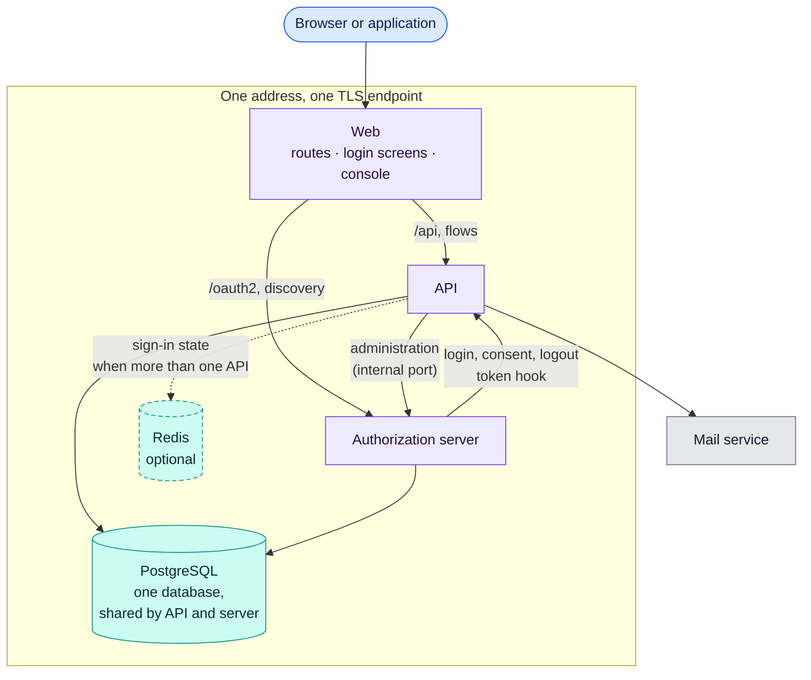

# Deployment

**Question:** which processes make up a deployment, and how do they talk?
**Level:** L1 · **Baseline:** `66120ac` (`deploy/`) · **Source:** `deploy/onprem/docker-compose.yml`
and this page

There is one build. A hosted deployment for many tenants and an installation on
one host run the same images with the same defaults; they differ by
configuration (see the constitution (`docs/CONSTITUTION.md`), principle 10).

| Unit | Responsibility | Notes |
|---|---|---|
| Web | The one public address: terminates TLS, serves the login screens and the console, routes API and authorization-server paths | In the installable bundle a reverse proxy; hosted, static hosting in front of the same API |
| API | Sign-in flows, administration, token endpoint, audit | Runs the database migrations at start |
| Authorization server | The protocol | Its administration port is internal only; the API is the one caller |
| PostgreSQL | Accounts, tenants, clients, audit, and the authorization server's own tables | API and authorization server share one database |
| Redis | Short-lived sign-in state (challenges, redirects, failure counters) | Optional. Off, the state lives in the API process, which then must run as one instance |

A change to a database schema ships in a deployment of its own: the code that
stops using a column or table is deployed first, and the migration that drops it
afterwards, because a dropped column cannot be rolled back with the binary.
