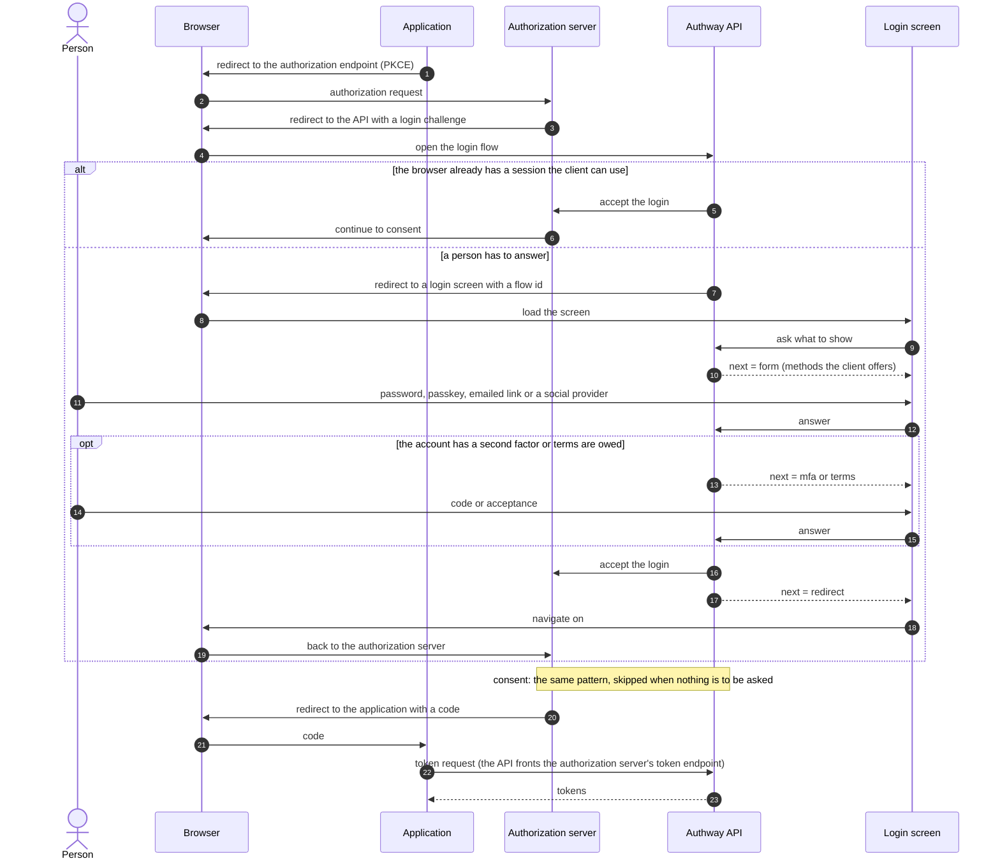
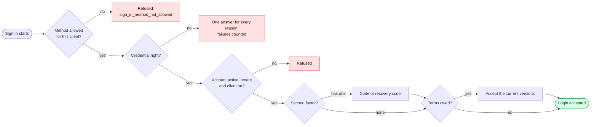

# Sign-in flow

**Question:** in what order do an application, the browser, the API, the login
screens and the authorization server cooperate until the application holds a
token — and where does a sign-in stop?
**Level:** L2 · **Baseline:** `a5a7056` (`apps/central/api/internal/handler`) ·
**Source:** the flow contract (`docs/api/login-flows.md`) and `packages/contract/openapi.yaml`;
this page only shows the order

The authorization server runs the protocol and asks the API, three times, for
what the protocol leaves open: who the person is (login), whether they agree
(consent), and what ends a session (logout). Each time it sends the browser to the
API with a challenge; the API either settles it at once or opens a screen with an
opaque **flow id** and answers the screen's questions until it can hand the
result back.

## What the screen is told

Every flow endpoint answers `next`, and the screen does exactly that:
`form` shows a form, `redirect` navigates, `mfa` asks for the second factor,
`terms` asks the person to accept the tenant's documents, `email_sent` says a
link was mailed. The screen holds no state of its own: the flow id is the only
thing it passes back, so a custom screen can replace the bundled one.

## Where a sign-in stops

The second factor is asked after **any** first factor, a passkey included: a
passkey is a first factor, not a way around the second. A failed credential gets
one answer whatever the reason, so the answer does not tell who has an account.

## Invariants

- The flow id is opaque. A flow is signed in once: an unknown id is
  `400 invalid_flow`, one that expired or was already completed is
  `410 flow_expired`. The sign-in screen stays up while the browser follows the
  redirect, so a flow that was signed in answers the user it signed in once
  more, for ten minutes, when they prove who they are again: the same redirect,
  and no second `user.login` entry. Submits that overlap are taken one after the
  other. A password for anyone else's account is not checked and is refused as a
  wrong one is, so the answer says nothing of whether it was right; a wrong
  credential is a failure like any other.
- A sign-in only opens the tenant the client belongs to; a person with accounts in
  two tenants has two accounts.
- A method is offered only where the client allows it: passkeys wherever the
  password form is offered (or where `passkey` is named), a social provider only
  where the client enables it and the deployment has credentials for it.
